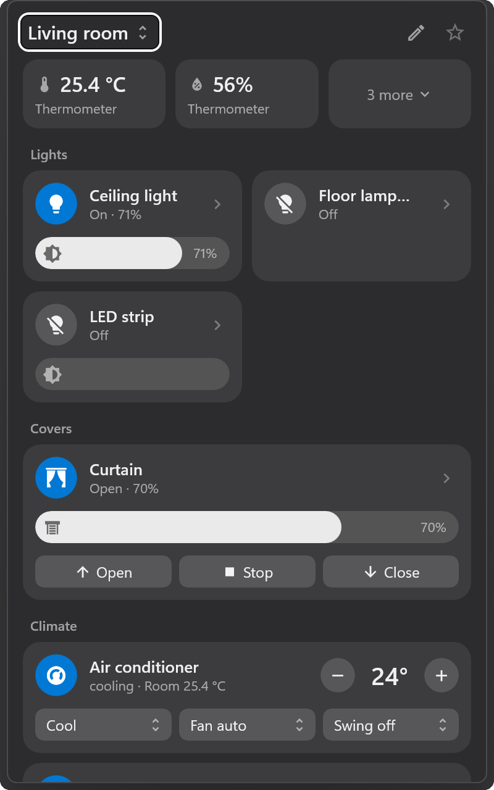
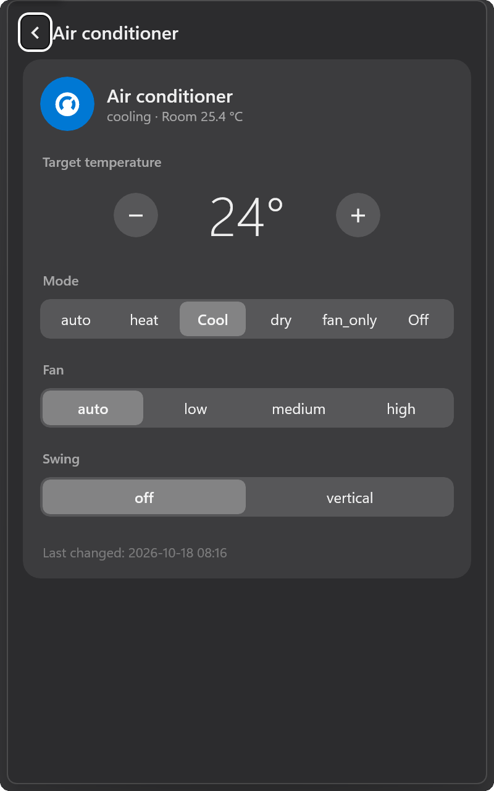
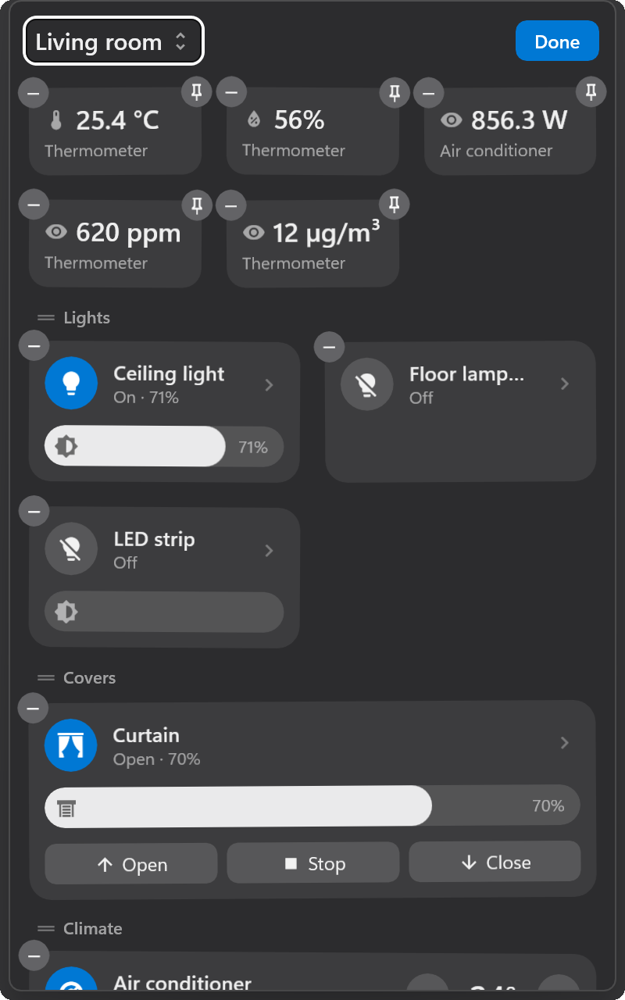

# HA Tray

HA Tray is a Windows tray application for Home Assistant. Selecting the tray icon opens a panel above the taskbar that presents the devices of one room. The panel closes when it loses focus. The visual design follows the macOS Control Center.

[中文说明](README.zh-CN.md)

<p align="center">
  
  
  
</p>
<p align="center"><sub>Main view · Climate detail page · Edit mode (sample data)</sub></p>

## Features

| Feature | Description |
|---|---|
| Rooms | Rooms correspond to Home Assistant areas and appear in the order defined in Home Assistant. A room can be marked as the default room. |
| Main view | Shows the entities that carry a configurable label (default `Tray`). Entities are grouped by type: lights, covers, climate, media, security, scenes and scripts, other. |
| Sensor chips | Sensors are shown as chips at the top of the room. Pinned chips remain visible when the chip area is collapsed. |
| All devices | Lists every entity of the room, grouped by device, including configuration and diagnostic entities. |
| Detail page | Provides the complete set of controls for an entity. |
| Edit mode | Reorders tiles, groups and chips by drag and drop; adds and removes entities; sets tile size, name and icon. |
| Room temperature | For climate entities that do not report a current temperature, a temperature sensor can be selected per room. |
| Synchronization | Layout settings are stored in Home Assistant and are therefore identical on every computer. |
| Localization | Names, icons and state texts are taken from Home Assistant, including its translations. The interface language follows the Home Assistant server language (Chinese or English) and can be set explicitly. |
| Live updates | States are updated in real time through the Home Assistant WebSocket API. |
| Appearance | Follows the Windows light or dark theme and the Windows accent color. |

## Supported entity types

Controls are selected according to the supported features and attributes that each entity reports, following the rules of the Home Assistant frontend.

| Domain | Main view | Detail page |
|---|---|---|
| `light` | On/off, brightness | Brightness, color temperature, color, effect |
| `climate` | On/off, target temperature, mode, fan mode, swing mode | Target temperature or range, mode, fan mode, swing mode, horizontal swing, preset, target humidity |
| `fan` | On/off, speed, preset | Speed, preset, oscillation, direction |
| `humidifier` | On/off, target humidity, mode | Target humidity, mode |
| `water_heater` | On/off, target temperature, operation mode | Target temperature, operation mode |
| `cover`, `valve` | Open, stop, close, position | Position, open, stop, close |
| `lock` | Lock, unlock | Lock, unlock, open (with confirmation) |
| `media_player` | On/off, previous, play/pause, next | Playback, volume, source |
| `vacuum`, `lawn_mower` | Start/pause, stop, return to dock | Commands, suction level |
| `select`, `input_select` | Option list | Option list |
| `number`, `input_number` | Slider or stepper | Slider or stepper |
| `switch`, `input_boolean`, `siren`, `remote`, `automation` | On/off | On/off |
| `button`, `input_button`, `scene`, `script` | Press, activate, run | Press, activate, run |
| `sensor`, `binary_sensor` | Chip with value | Value |
| Other domains | State | State; on/off when the domain provides both services |

## Requirements

| Item | Requirement |
|---|---|
| Operating system | Windows 10 version 2004 (build 19041) or later; Windows 11 recommended |
| Runtime | [.NET 10 Desktop Runtime](https://dotnet.microsoft.com/download/dotnet/10.0) |
| Home Assistant | A long-lived access token. Editing the panel from the application requires an administrator account. |

## Installation and setup

1. Start `HaTray.exe`. The settings window opens on first start.
2. Enter the Home Assistant address, for example `http://homeassistant.local:8123`.
3. Create a long-lived access token in Home Assistant under Profile → Security → Long-lived access tokens, and enter it. The token is stored only on the local computer, encrypted for the current Windows user (`%LOCALAPPDATA%\HaTray\settings.json`).
4. Save the settings.

Entities are added to the main view either by assigning the label in Home Assistant or through edit mode in the panel.

The context menu of the tray icon provides: Open panel, Open Home Assistant in browser, Settings, Start with Windows, Exit.

On Windows 11, new tray icons may be placed in the overflow area. The icon can be kept visible under Settings → Personalization → Taskbar → Other system tray icons.

## Data stored in Home Assistant

HA Tray stores its layout in Home Assistant through the public WebSocket API.

| Data | Location |
|---|---|
| Entities on the main view | The label configured in the settings |
| Order, tile size, pinned chips | Entity registry options, namespace `ha_tray` |
| Names and icons changed in the panel | The entity's name and icon in the entity registry |
| Room temperature and humidity sensor | The area settings |

## Building

Requires the .NET 10 SDK.

```
dotnet build src\HaTray -c Release -p:Platform=x64
```

The output is written to `src\HaTray\bin\x64\Release\…\win-x64\`. The folder can be copied to any location.

| Option | Purpose |
|---|---|
| `--demo` | Runs with built-in sample data, without Home Assistant |
| `--debug` | Enables the text debug channel. Normal mode uses `%LOCALAPPDATA%\HaTray`; `--demo` uses `DemoData` beside the executable |
| `--lang=en`, `--lang=zh` | Sets the interface language for the current run only |

The screenshots are generated with `tools\make-screenshots.ps1`. Design notes are available in [docs/design.md](docs/design.md) (Chinese).

## License

HA Tray is released under the MIT License. Icons are from [Material Design Icons](https://pictogrammers.com/library/mdi/) and are licensed under the Apache License 2.0 (see `src/HaTray/Assets/mdi-LICENSE.txt`).

HA Tray is not affiliated with Home Assistant or the Open Home Foundation.
