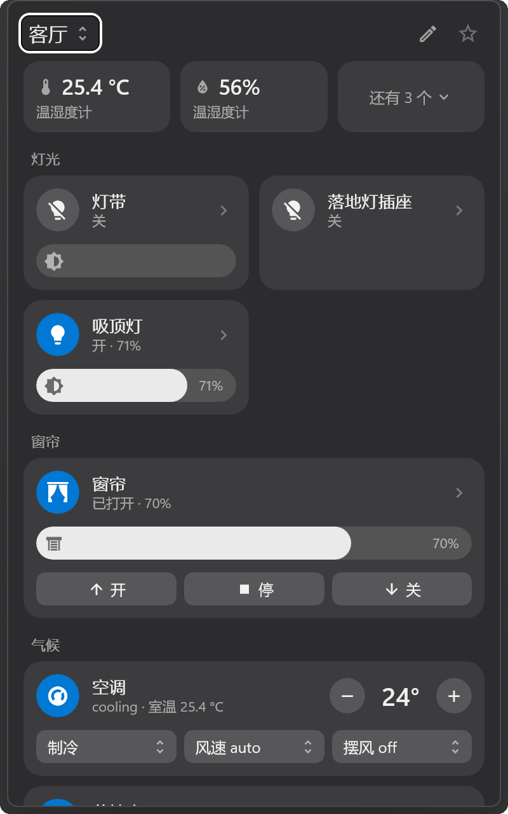
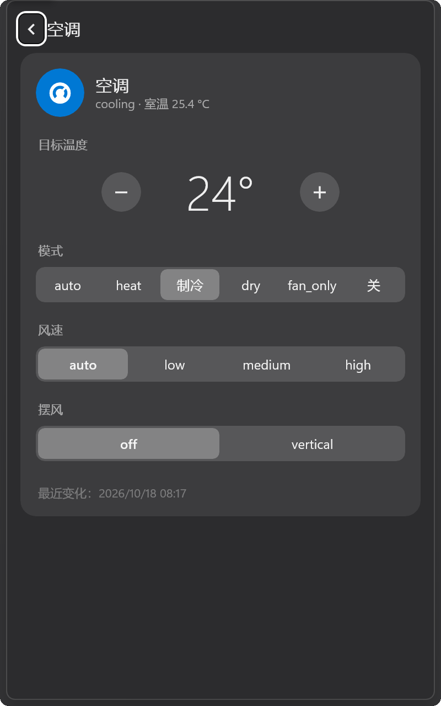
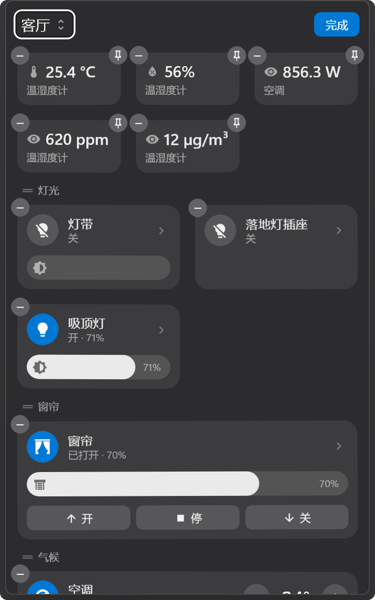

# HA Tray

HA Tray 是 Home Assistant 的 Windows 托盘应用。单击托盘图标后，任务栏上方弹出面板，显示一个房间内的设备；面板失去焦点时自动收起。界面风格参照 macOS 控制中心。

[English](README.md)

<p align="center">
  
  
  
</p>
<p align="center"><sub>主界面 · 空调详情页 · 编辑模式（演示数据）</sub></p>

## 功能

| 功能 | 说明 |
|---|---|
| 房间 | 房间对应 Home Assistant 的区域，顺序与 Home Assistant 中的区域顺序一致。可指定默认房间。 |
| 主界面 | 显示带有指定标签（默认为「托盘」）的实体，按类型分组：灯光、窗帘、气候、媒体、安防、场景和脚本、其他。 |
| 环境胶囊 | 传感器以胶囊形式显示在房间顶部。已固定的胶囊在收起状态下仍然显示。 |
| 更多设备 | 按设备分组列出房间内的全部实体，包括配置类和诊断类实体。 |
| 详情页 | 提供单个实体的全部控件。 |
| 编辑模式 | 通过拖放调整磁贴、分组和胶囊的顺序；添加或移除实体；设置磁贴的大小、名称和图标。 |
| 室温 | 对于不提供当前温度的空调，可按房间指定温度传感器。 |
| 同步 | 布局设置保存在 Home Assistant 中，各台计算机上的面板保持一致。 |
| 本地化 | 名称、图标和状态文字取自 Home Assistant，包括其翻译。界面语言跟随 Home Assistant 服务器语言（中文或英文），也可在设置中指定。 |
| 实时更新 | 通过 Home Assistant WebSocket 接口实时更新状态。 |
| 外观 | 跟随 Windows 的深色或浅色主题及强调色。 |

## 支持的实体类型

控件根据实体报告的功能位和属性选择，判断规则与 Home Assistant 前端一致。

| 类型 | 主界面 | 详情页 |
|---|---|---|
| `light` | 开关、亮度 | 亮度、色温、颜色、效果 |
| `climate` | 开关、目标温度、模式、风速、摆风 | 目标温度或温度区间、模式、风速、摆风、水平摆风、预设、目标湿度 |
| `fan` | 开关、风量、预设模式 | 风量、预设模式、摆头、方向 |
| `humidifier` | 开关、目标湿度、模式 | 目标湿度、模式 |
| `water_heater` | 开关、目标温度、运行模式 | 目标温度、运行模式 |
| `cover`、`valve` | 打开、停止、关闭、位置 | 位置、打开、停止、关闭 |
| `lock` | 上锁、解锁 | 上锁、解锁、开门（需二次确认） |
| `media_player` | 开关、上一首、播放/暂停、下一首 | 播放控制、音量、音源 |
| `vacuum`、`lawn_mower` | 开始/暂停、停止、回充 | 控制命令、吸力 |
| `select`、`input_select` | 选项列表 | 选项列表 |
| `number`、`input_number` | 滑条或步进器 | 滑条或步进器 |
| `switch`、`input_boolean`、`siren`、`remote`、`automation` | 开关 | 开关 |
| `button`、`input_button`、`scene`、`script` | 按下、启用、运行 | 按下、启用、运行 |
| `sensor`、`binary_sensor` | 胶囊显示读数 | 读数 |
| 其他类型 | 状态 | 状态；类型同时提供开启和关闭服务时显示开关 |

## 系统要求

| 项目 | 要求 |
|---|---|
| 操作系统 | Windows 10 2004（内部版本 19041）及以上，推荐 Windows 11 |
| 运行时 | [.NET 10 桌面运行时](https://dotnet.microsoft.com/download/dotnet/10.0) |
| Home Assistant | 长期访问令牌。在应用内编辑面板需要管理员账户。 |

## 安装与设置

1. 运行 `HaTray.exe`，首次运行时打开设置窗口。
2. 填写 Home Assistant 地址，例如 `http://homeassistant.local:8123`。
3. 在 Home Assistant 的「个人资料 → 安全 → 长期访问令牌」中创建令牌并填入。令牌仅保存在本机，按当前 Windows 用户加密（`%LOCALAPPDATA%\HaTray\settings.json`）。
4. 保存设置。

向主界面添加实体有两种方式：在 Home Assistant 中为实体添加标签，或在面板的编辑模式中添加。

托盘图标的右键菜单包含：打开面板、在浏览器中打开 Home Assistant、设置、开机时启动、退出。

在 Windows 11 中，新出现的托盘图标可能被收入溢出区域。可在「设置 → 个性化 → 任务栏 → 其他系统托盘图标」中设置为始终显示。

## 保存在 Home Assistant 中的数据

HA Tray 通过 Home Assistant 的公开 WebSocket 接口保存布局。

| 数据 | 位置 |
|---|---|
| 主界面上的实体 | 设置中指定的标签 |
| 顺序、磁贴大小、固定的胶囊 | 实体注册表选项，命名空间 `ha_tray` |
| 在面板中修改的名称和图标 | 实体注册表中实体的名称和图标 |
| 房间的温度、湿度传感器 | 区域设置 |

## 构建

需要 .NET 10 SDK。

```
dotnet build src\HaTray -c Release -p:Platform=x64
```

输出位于 `src\HaTray\bin\x64\Release\…\win-x64\`，可将整个文件夹复制到任意位置运行。

| 参数 | 用途 |
|---|---|
| `--demo` | 使用内置演示数据运行，不连接 Home Assistant |
| `--debug` | 启用文字调试通道。正常模式使用 `%LOCALAPPDATA%\HaTray`；`--demo` 使用程序目录下的 `DemoData` |
| `--lang=en`、`--lang=zh` | 仅为本次运行指定界面语言 |

截图由 `tools\make-screenshots.ps1` 生成。设计说明见 [docs/design.md](docs/design.md)。

## 许可

HA Tray 以 MIT 许可证发布。图标来自 [Material Design Icons](https://pictogrammers.com/library/mdi/)，采用 Apache License 2.0（见 `src/HaTray/Assets/mdi-LICENSE.txt`）。

HA Tray 与 Home Assistant 及 Open Home Foundation 无隶属关系。
